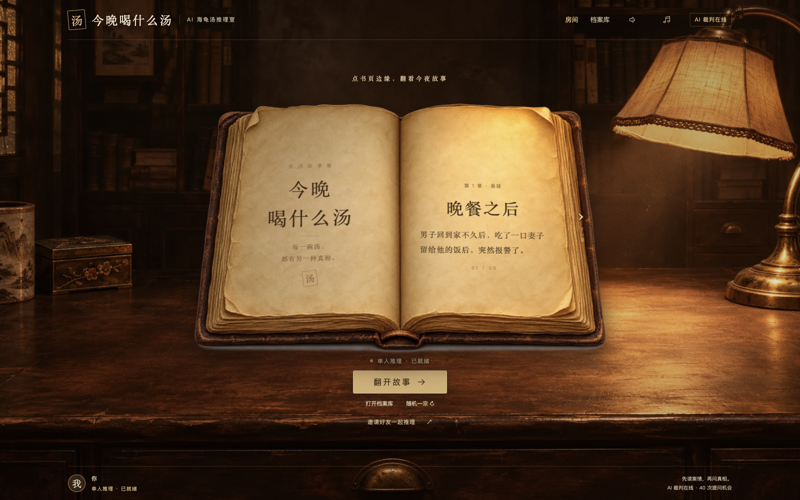
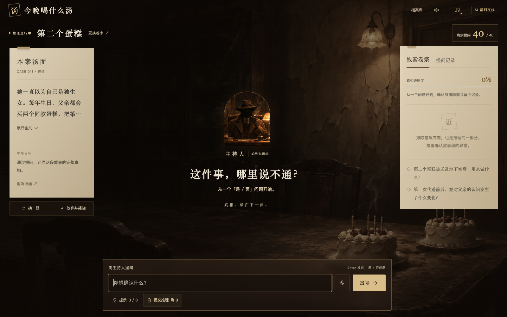
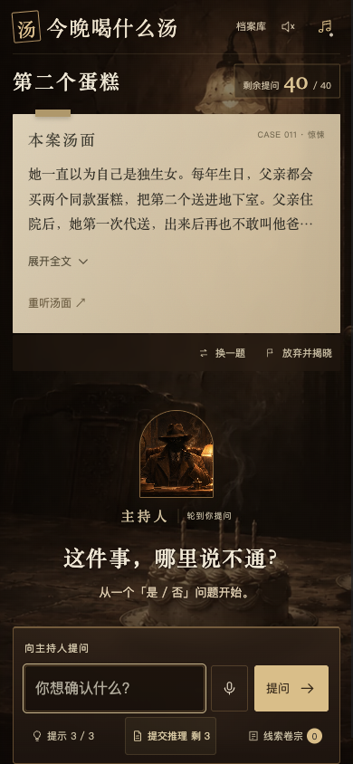

# 今晚喝什么汤

一款可以独自推理、也可以邀请朋友同桌讨论的 AI 海龟汤游戏。翻开台灯下的旧书，从一段看似说不通的故事开始，用有限的问题拼出真相。

**[在线试玩 →](https://tonight-turtle-soup.onrender.com)** · [本地运行](#本地运行) · [部署说明](DEPLOY.md)



## 从翻书到结案

首页是一张暖色书桌和一本旧书。点击左右书页边缘切换章节，书页只留下悬念，首次翻开后再用完整句子讲述汤面。开场可以暂停、重播或跳过；同一浏览器重玩已读章节会直接进入推理室，也可在案情旁重新听汤面。

每局有 **40 次提问机会、3 次提示和 3 次提交推理机会**。向 AI 主持人提出一个能用“是／否”回答的问题，裁判会返回“是”“否”“无关”或“无法判断”。无效提问和故事未交代的问题不扣次数；重复问过的有效问题直接复用已有判定。

问中关键事实后，线索卡只保留原问句与已确认的回答，避免自动补出尚未问到的答案；否定回答单独收进「已排除」。真相还原度只反映关键事实覆盖，排除方向不强行折算为分数。提交完整解释后，覆盖全部核心事实且加权得分达到 70% 才能结案。

三宗精选案件包含随已确认事实变化的场景演出：《第二个蛋糕》的旧宅房门、《电梯里的人》的密闭轿厢，以及《谢幕后的掌声》的空舞台。画面和短环境声跟随真实进度，重连不重复播放，同伴或主持人说话时避让音效，并尊重音乐开关与减少动态效果设置。阶段素材说明见 [演出配图](docs/CASE_ATMOSPHERE_ART.md)。

结案后可以沿时间线回看最多三次关键突破、排除的猜测，以及重新确认已知线索或调整问法的次数。下一题根据是否成功、提示使用和提问次数调整推荐难度，并优先衔接尚未玩过的精选案件。还可查看本机最佳纪录，生成无剧透战绩图片及挑战链接；分享图片只含公开案件名、封面与本局统计，不包含汤底或问句。



## 一个人想，或一桌人一起想

| 体验 | 当前实现 |
| --- | --- |
| 单人推理 | 选择案件、连续提问、解锁线索、使用提示、提交完整推理和结案复盘 |
| 最多 8 人房间 | 创建房间后分享邀请链接，真实玩家加入并准备，房主开局 |
| 共享进度 | 全房间共用提问、提示、提交机会及线索，SSE 实时同步问题记录与状态 |
| 同桌讨论 | 文字讨论区与 WebRTC 语音连麦；主持人回答时避免重复提交、并发扣次 |
| 主持人旁白 | 可配置豆包“悬疑解说 2.0”，用于开场、裁判回答、重播和汤底揭晓 |
| 环境音乐 | 默认开启，首次点击页面后播放；支持开关、音量与循环，旁白或同伴说话时压低音乐 |
| 手机界面 | 单列推理舞台与线索抽屉，保留提问和结案操作 |

连麦需要 HTTPS 或 localhost，以及浏览器麦克风权限。目前使用 STUN 直连，部分受限网络需要另行配置 TURN；文字讨论和共享推理不依赖麦克风。

<p align="center">
  
</p>

## 当前案件

内置 13 宗案件，包含深夜尾随、密闭空间、藏匿与犯罪伪装等题材。默认书页与随机选题推荐 12 宗惊悚悬疑案件；旧《完美犯罪》移至档案库「全部卷宗」，已有链接仍可打开。

| 案件 | 题材 | 难度 |
| --- | --- | --- |
| 晚餐之后 | 悬疑 | ★★☆ |
| 打折的零食 | 悬疑 | ★★☆ |
| 全家福 | 悬疑 | ★★☆ |
| 完美犯罪 | 人性 | ★★★ |
| 开门以后 | 心理 | ★★★ |
| 最后一杯水 | 惊悚 | ★★☆ |
| 电梯里的人 | 心理 | ★★☆ |
| 熄灯之后 | 悬疑 | ★★☆ |
| 半根火柴 | 惊悚 | ★★★ |
| 倒回去的录音 | 悬疑 | ★★★ |
| 第二个蛋糕 | 惊悚 | ★★★ |
| 谢幕后的掌声 | 惊悚 | ★★★ |
| 镜子里的九点 | 悬疑 | ★★☆ |

想先玩一局的朋友，可以暂时跳过题库源码；`server/puzzles.js` 包含完整汤底。

## 本地运行

需要 **Node.js 22 或更新版本**，无需前端构建。

```sh
git clone https://github.com/YEMIN11238/tonight-turtle-soup.git
cd tonight-turtle-soup
npm ci
cp .env.example .env
npm start
```

打开 [http://localhost:8787](http://localhost:8787)。未填写模型密钥时，游戏进入离线规则演示模式，适合查看界面和流程；完整的自然语言裁判与判卷需要配置模型服务。

在本机 `.env` 或托管平台的环境变量中配置所需服务，字段见 [`.env.example`](.env.example)：

| 配置项 | 用途 |
| --- | --- |
| `OPENAI_API_KEY`、`OPENAI_MODEL` | OpenAI 裁判与判卷；示例模型为 `gpt-5.4-mini` |
| `ANTHROPIC_API_KEY`、`ANTHROPIC_MODEL` | 可选 Claude 服务；配置 OpenAI 时优先使用 OpenAI |
| `VOLC_SPEECH_API_KEY` | 可选豆包语音服务专用 Key |
| `VOLC_TTS_RESOURCE`、`VOLC_TTS_SPEAKER`、`VOLC_TTS_NAME` | 语音资源、音色及显示名称 |
| `ACCESS_CODE` | 可选开局口令 |
| `DAILY_LLM_LIMIT`、`DAILY_TTS_CHAR_LIMIT` | 全站每日模型调用、新合成语音字数上限 |
| `PORT`、`DATA_DIR` | 服务端口及可写数据目录 |
| `DATA_PERSISTENT`、`SESSION_TTL_DAYS` | 已确认的持久目录标记与单人存档保留天数，默认 30 天 |

所有服务密钥只在后端使用，不发送到浏览器。`.env` 和包含玩家凭据的数据目录已加入忽略规则。未配置豆包时可使用浏览器系统语音；豆包已配置但请求失败时会提示错误，文字玩法仍可继续。

运行现有测试：

```sh
npm test
```

## 技术与目录

前端使用原生 HTML、CSS 和 JavaScript 模块，翻页效果由 Canvas 绘制。后端使用 Node.js 与 Express；OpenAI 接口通过原生 `fetch` 调用，Claude 使用官方 SDK。多人状态与文字讨论通过 SSE 推送，语音通道使用 WebRTC。

| 路径 | 职责 |
| --- | --- |
| `public/app.js` | 首页、开场、推理、线索与结案交互 |
| `public/book-turn.js` | 旧书翻页与章节切换动效 |
| `public/narrator.js`、`public/sound.js` | 主持人语音、背景音乐及音量协调 |
| `public/room-client.js`、`public/room-voice.js` | 房间同步与语音连麦 |
| `server/index.js` | HTTP API 与单人会话 |
| `server/game.js` | 次数、线索、事实覆盖、判分和公开状态 |
| `server/llm.js`、`server/openai.js` | AI 裁判与判卷 |
| `server/rooms.js` | 多人房间、SSE、共享状态与持久化 |
| `server/tts.js` | 豆包语音、公开文本校验、缓存与额度 |
| `server/puzzles.js` | 题库与完整答案，阅读会剧透 |
| `test/` | 游戏规则、房间与语音接口测试 |

游戏接口在结案前只向玩家提供公开信息；语音接口也只允许合成本局已经公开的内容。仓库公开源码中保留完整题库，适合阅读和修改游戏逻辑。

## 在线部署

这是包含后端的完整应用，需要长期运行的 Node.js 服务，或支持 SSE 的容器主机。仓库提供 [Render 配置](render.yaml) 和 [Dockerfile](Dockerfile)，完整步骤见 [DEPLOY.md](DEPLOY.md)。

- **保持单进程、单实例。** 房间广播和单人会话使用进程内状态，不能直接增加副本。
- **使用 HTTPS 并支持 SSE。** 反向代理关闭 SSE 响应缓冲，允许长连接。
- **使用已有服务器上的固定数据目录。** 将 `DATA_DIR` 指向代码目录以外的可写持久目录；单人对局、多人房间及调用用量写入该目录。单人对局按最后活动时间保留 30 天，落盘成功后才确认操作；更新代码、替换部署目录或重启进程时继续使用同一数据目录。
- **Render 免费实例有冷启动和临时文件系统限制。** 休眠后首次打开可能需要等待，重启或重新部署可能丢失未持久化的数据。长期房间应使用带持久卷的实例。

部署后可通过 `/api/meta` 查看实际模型模式和语音配置，再验证单人提问及多人房间同步。

## 素材与题目来源

最初 5 宗案件沿用源码注明的 TurtleSoup-Bench 中文题；后续案件结合经典谜题机制与新编惊悚情境，重新编排汤面、世界设定、线索与判分事实。场景与旧书包含 AI 生成的美术资源。

新增 8 张独立场景图的文件路径与生成提示词见 [场景图清单](docs/NEW_CASE_ART.md)。

当前背景音乐由使用者提供，文件为 `user-bgm-20261108.mp3`；主持人试听使用预先合成的欢迎语音 `welcome-tonight-20261108.mp3`。音频文件说明见 [`public/audio/CREDITS.txt`](public/audio/CREDITS.txt)。
