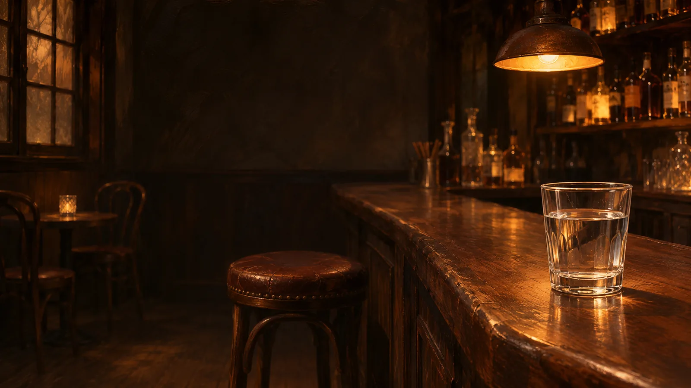
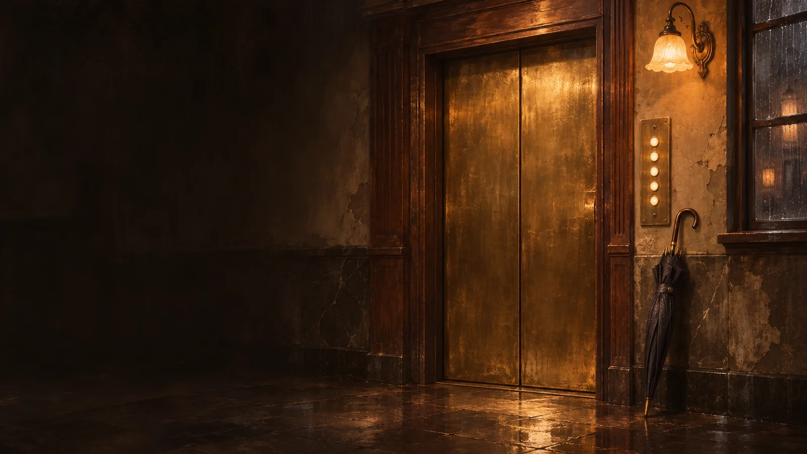
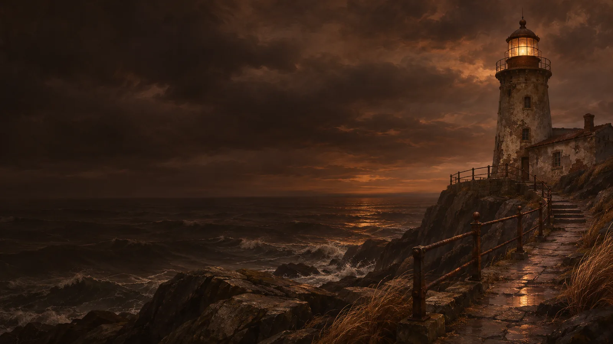
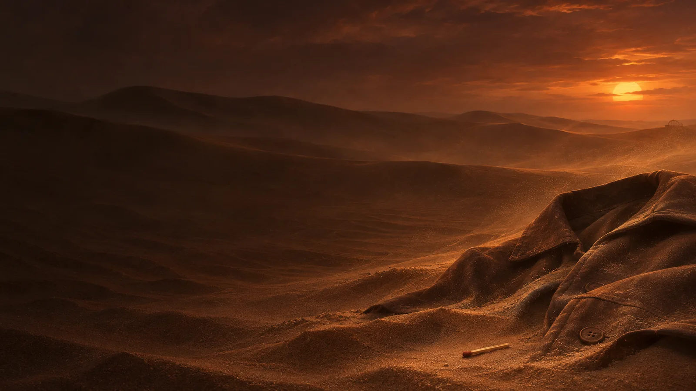
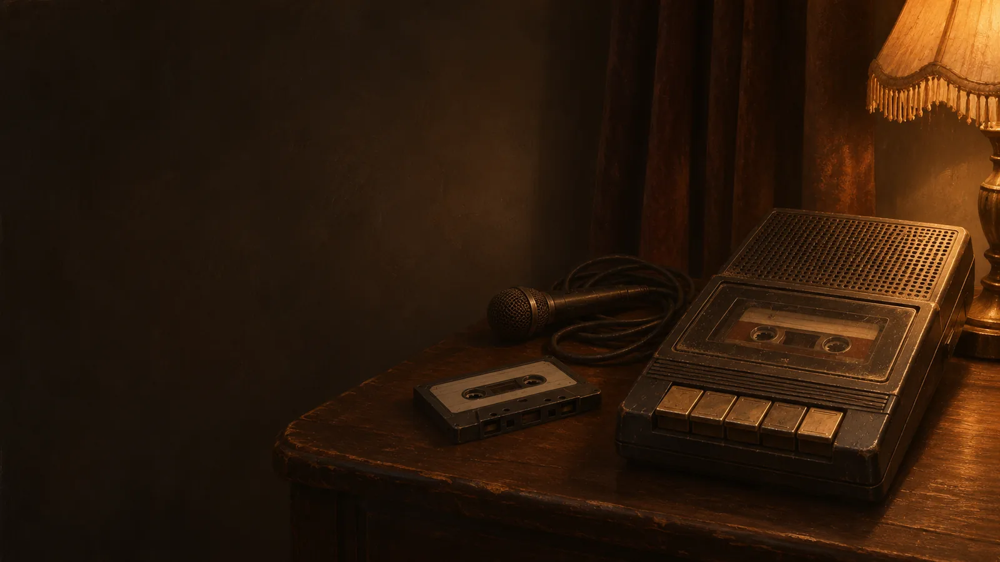
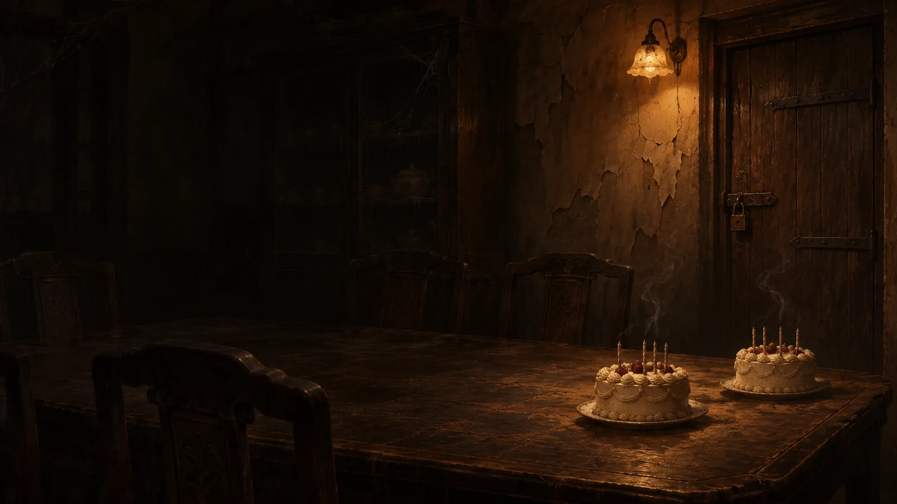
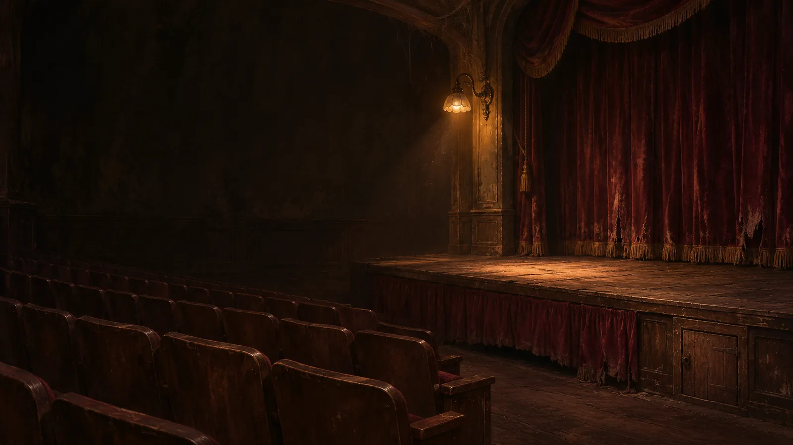
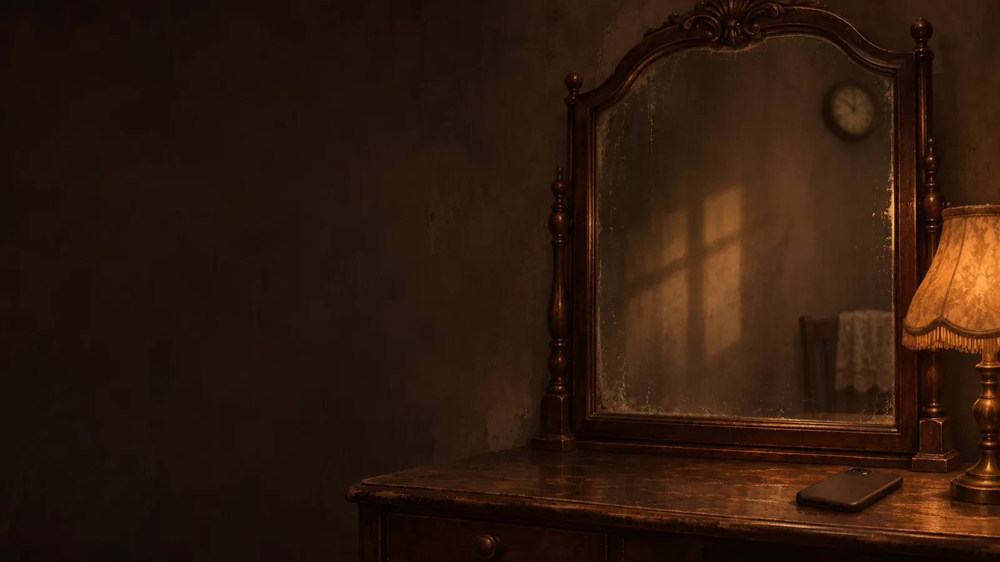

# 新增剧本场景图

本轮使用内置 `image_gen` 为 8 个新增惊悚剧本分别生成场景图。所有最终运行资源均已导出到项目内，完整图约 1600 像素宽，缩略图约 640 像素宽。原始 PNG 留在已忽略的 `public/assets/orig/`。

图片用于烘托气氛，画面中的陈设不自动构成剧情事实。

## 第三个人



- 完整图：`public/assets/water-glass.webp`
- 缩略图：`public/assets/water-glass-sm.webp`
- 生成方式：内置 image_gen

<details>
<summary>生成提示词</summary>

```text
Use case: stylized-concept. Asset type: atmospheric full-screen case illustration for the existing Chinese mystery game 今晚喝什么汤. Primary request: one still scene for a puzzle about a visitor asking for a glass of water at a bar. Scene: intimate old neighborhood bar after dark, single clear glass of plain water on a worn walnut counter in the lower right foreground, blurred amber bottles and one warm pendant lamp in the background, an empty bar stool just outside center. Cinematic realistic painterly noir art, rich tactile wood, glass reflections, amber tungsten light, espresso brown and sepia charcoal palette matching a lamplit antique-book game. Wide 16:9 landscape, central and left thirds quiet dark room for overlaid detective portrait and question UI; important glass clearly visible on right. Suspenseful but restrained, preserve visible textures. No people, no weapons, no bartender action, no signs of hiccups, no solution reveal. No text, lettering, numbers, logos, UI, watermark. Absolutely no green, teal or blue dominant lighting. Opaque background.
```

</details>

## 电梯里的人



- 完整图：`public/assets/rainy-elevator.webp`
- 缩略图：`public/assets/rainy-elevator-sm.webp`
- 生成方式：内置 image_gen

<details>
<summary>生成提示词</summary>

```text
Use case: stylized-concept. Asset type: atmospheric full-screen case illustration for the Chinese mystery game 今晚喝什么汤. Primary request: an old apartment elevator on a rainy evening, for a puzzle involving different elevator journeys on rainy and sunny days. Scene: aged brass elevator doors and softly illuminated unlabeled button panel on the right; a neatly folded long dark umbrella leaning beside the elevator near the lower right, small wet reflections on worn stone lobby floor, amber wall sconce light. Cinematic realistic painterly noir, walnut and aged brass, warm sepia and charcoal shadows, tactile old apartment textures, rain outside hinted by a far frosted window. Wide landscape 16:9, keep center and left area spacious and dark for a detective portrait and white question text, main elevator-and-umbrella grouping in right half. No people, no extreme button heights, no arrows or demonstration of umbrella touching buttons, do not disclose puzzle solution. No readable numbers, floor labels, text, logos, UI or watermark. No green, teal, cyan or blue dominant cast. Opaque.
```

</details>

## 熄灯之后



- 完整图：`public/assets/lighthouse-night.webp`
- 缩略图：`public/assets/lighthouse-night-sm.webp`
- 生成方式：内置 image_gen

<details>
<summary>生成提示词</summary>

```text
Use case: stylized-concept. Asset type: landscape 16:9 atmospheric background illustration for the Chinese noir mystery game 今晚喝什么汤, not a UI mockup. Style: cinematic realistic painterly illustration, rich tactile detail, warm walnut brown, amber, aged sepia, espresso and charcoal. Maintain visible textures in shadows; restrained suspense, not gore. Quiet darker left half and central area for interface copy and portrait overlaid later; important scene props clearly readable toward right third or lower right. No typography, words, numbers, logo, watermark, user interface or frame. No dominant green, teal or cold blue. Wide landscape composition. Scene: A solitary weathered stone lighthouse on a rocky coast at deep dusk, seen from a nearby path across dark wind-swept stones. The tower stands on the right third with a small warm amber lantern room glowing above, reflected faintly on the sea. Moody layered brown-gray storm clouds, rough dark water, wet rock textures, old iron railing, a distant empty horizon. The left and middle are atmospheric open sea and shadowed headland with room for UI. The lamp is modest, not a blinding laser beam. No ship, no wreckage, no people, no bodies, no visible accident. This is a mysterious setting, not an image of the solution.
```

</details>

## 半根火柴



- 完整图：`public/assets/desert-match.webp`
- 缩略图：`public/assets/desert-match-sm.webp`
- 生成方式：内置 image_gen

<details>
<summary>生成提示词</summary>

```text
Use case: stylized-concept. Asset type: landscape 16:9 atmospheric background illustration for the Chinese noir mystery game 今晚喝什么汤, not a UI mockup. Style: cinematic realistic painterly illustration, rich tactile detail, warm walnut brown, amber, aged sepia, espresso and charcoal. Maintain visible textures in shadows; restrained suspense, not gore. Quiet darker left half and central area for interface copy and portrait overlaid later; important scene props clearly readable toward right third or lower right. No typography, words, numbers, logo, watermark, user interface or frame. No dominant green, teal or cold blue. Wide landscape composition. Scene: An expansive windblown ochre desert at twilight, low close viewpoint over finely textured sand ridges and receding dunes. In the lower right foreground lies a single small wooden match beside a worn folded dark brown travel coat half-covered with sand. A tiny indistinct wicker shape very far away near the right horizon is optional and must remain ambiguous. Raking amber last light, long soft shadows, suspended dust, empty haunting silence. Center and left remain open darkened dunes. No visible person or body, no nudity, no bones, no balloon, no aircraft, no ropes explaining the story. No lit match or fire. Small match must remain a plausible understated prop.
```

</details>

## 倒回去的录音



- 完整图：`public/assets/recording-alibi.webp`
- 缩略图：`public/assets/recording-alibi-sm.webp`
- 生成方式：内置 image_gen

<details>
<summary>生成提示词</summary>

```text
Use case: stylized-concept. Asset type: atmospheric full-screen case illustration for the Chinese mystery game 今晚喝什么汤. Primary request: a vintage cassette tape recorder in a silent room for a detective puzzle about a mysterious recording. Scene: one portable 1980s analog cassette recorder with a cassette visible behind its transparent window, resting on an old dark wooden side table in the lower right, a second loose blank cassette and coiled microphone wire nearby, weak amber lamp pool at the edge of frame, shadowed plain wall and heavy curtain behind. Realistic painterly cinematic noir with detailed worn plastic, brass-toned buttons, dust and magnetic tape texture; warm espresso brown, muted amber and charcoal sepia. Wide 16:9 landscape; left and center quiet darker negative space for game character and question overlays; recorder dominant in right lower third. No bodies, no blood, no weapon, no suicide note, no rewind arrows or explanatory clue, no suggestion of how recording was made. No readable text, lettering, numbers, logos, UI, watermark. No green/teal/blue lighting. Opaque background.
```

</details>

## 第二个蛋糕



- 完整图：`public/assets/second-cake.webp`
- 缩略图：`public/assets/second-cake-sm.webp`
- 生成方式：内置 image_gen

<details>
<summary>生成提示词</summary>

```text
Use case: stylized-concept. Asset type: landscape 16:9 atmospheric background for a Chinese horror mystery game, not a UI mockup. Create an ominous, realistic painterly scene in an EMPTY, old family dining room at night. On the lower-right part of a worn walnut dining table sit TWO small IDENTICAL cream birthday cakes, carefully set apart. Their candles have already burned out, leaving thin smoke and dark wicks; there are NO glowing candle flames. In the right background stands a weathered firmly CLOSED basement door with old dark iron fittings and a subtle visible padlock. No view through the door. A single weak amber wall light illuminates the cakes and a narrow patch of peeling plaster, while heavy charcoal shadows occupy the empty chairs, left half and center of the scene for game UI overlay. The mood is threatening and oppressive, suggesting a celebration with something deeply wrong, NEVER cozy, cheerful or sentimental. Detailed aged wood, stale dust and cracked plaster, warm espresso brown, muted sepia, exhausted amber and near-black umber. Preserve readable textures in darkness. No people, no children, no captive, no silhouettes of people, no human hands, no blood or gore, no toys, no calendar, no numeric candles, no text, no symbols, no logo, no watermark, no UI. No green, teal or blue lighting. Wide cinematic landscape.
```

</details>

## 谢幕后的掌声



- 完整图：`public/assets/after-curtain.webp`
- 缩略图：`public/assets/after-curtain-sm.webp`
- 生成方式：内置 image_gen

<details>
<summary>生成提示词</summary>

```text
Use case: stylized-concept. Asset type: landscape 16:9 atmospheric background for a Chinese horror mystery game, not a UI mockup. An ABANDONED EMPTY small vintage theatre after closing time, seen diagonally from the rear of the auditorium. The right third contains an old raised wooden stage and dusty burgundy red velvet curtains hanging still. A narrow dark gap beneath the stage skirt, or a small closed wooden stage hatch near its edge, hints at hidden space without showing anything inside. Rows of completely EMPTY walnut theatre seats recede across the lower left. One tired amber house lamp casts a small pool of light on worn stage floorboards, leaving the center and upper left in quiet oppressive charcoal shadow for UI copy and a host portrait. Realistic painterly cinematic horror game art with tactile dust, frayed velvet, aged brass and splintered dark wood. Muted warm walnut brown, sepia, dim burnt amber and near-black umber, no dominant cool colors. Threatening silence, NOT festive, NOT an award ceremony, NOT an applause scene. No person, no audience, no hands, no silhouettes, no figures in seats, no face, no skeleton, no bodies, no blood, no written messages, no SOS, no symbols, no typography, no logo, no watermark or UI. Keep shadow textures readable without brightening the mood. Wide 16:9 landscape.
```

</details>

## 镜子里的九点



- 完整图：`public/assets/mirror-alibi.webp`
- 缩略图：`public/assets/mirror-alibi-sm.webp`
- 生成方式：内置 image_gen

<details>
<summary>生成提示词</summary>

```text
Use case: stylized-concept. Asset type: atmospheric full-screen case illustration for the Chinese mystery game 今晚喝什么汤. Primary request: a dim old apartment dressing mirror and analog wall clock, for a puzzle about a photograph used as an alibi. Scene: a tall antique mirror with a dark walnut frame in the right half, reflecting part of a softly lit wall and a small round analog clock high at the far edge; an unlit smartphone face down on a worn dressing table at lower right, one amber shaded bedside lamp off to the side, soft empty-room shadows. Refined realistic painterly cinematic noir, aged glass, walnut, warm sepia, amber tungsten and charcoal. Wide 16:9 landscape, center and left quiet dark negative space suitable for detective portrait and white question UI. Clock face must be indistinct and too small to read any exact time or numerals; no contradictory duplicate clocks, no diagram, no explicit mirroring explanation, no solution reveal. No people or faces in mirror, no blood, no text, labels, logos, UI or watermark. Absolutely no green/teal/blue cast. Opaque background.
```

</details>
